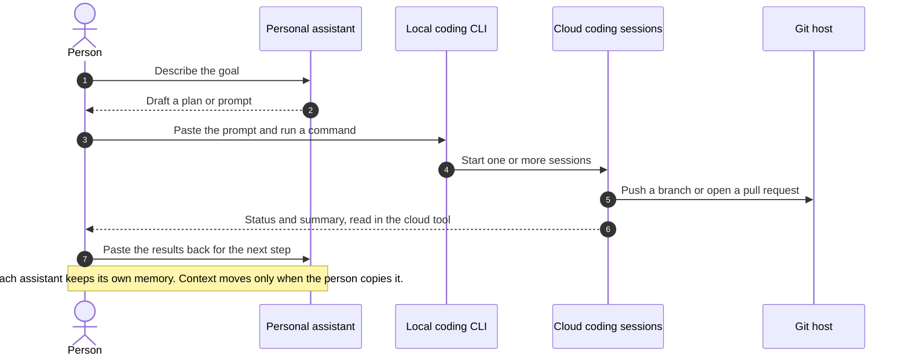
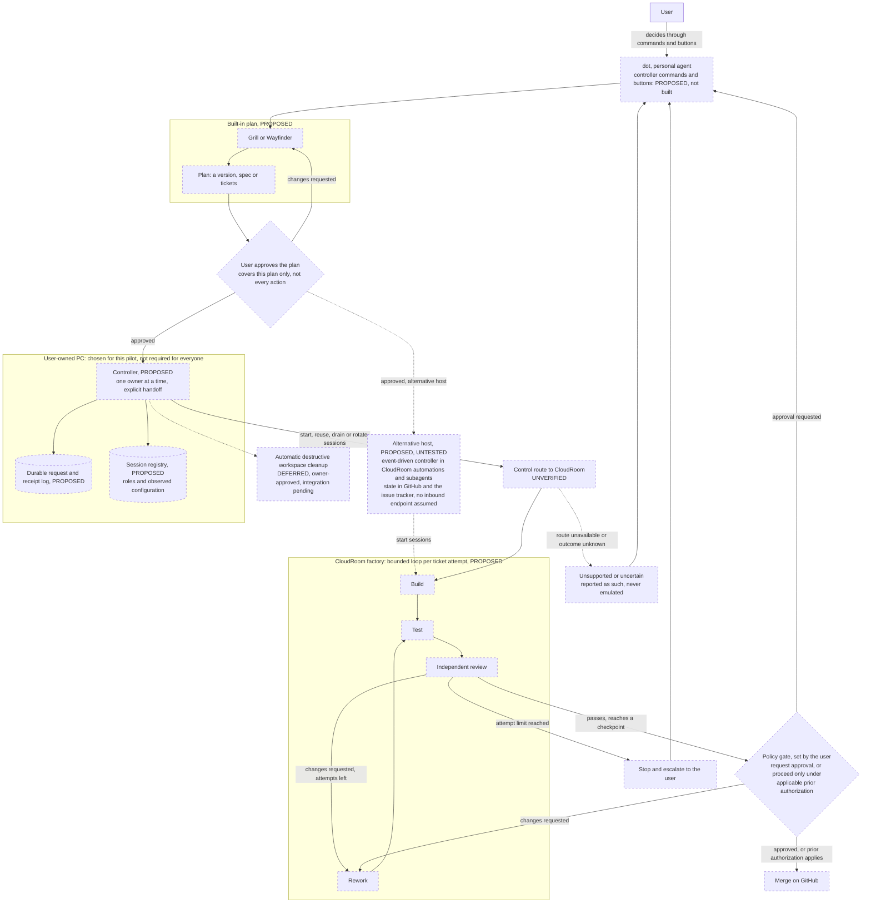
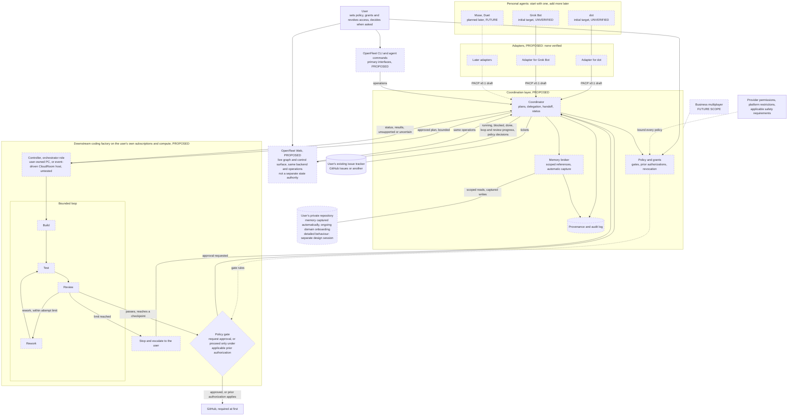
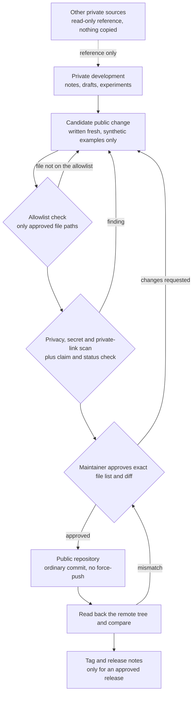

# Architecture diagrams

These diagrams are Mermaid source; GitHub renders them in place. Each node is labelled **Current**, **Unverified**, **Proposed**, **Deferred** or **Future**. Dashed outlines mark anything that is not current behaviour.

## 1. Current: the manual workflow

**Status: Current.** This is how work moves today, entirely by hand. No OpenFleet software is involved. The person is the integration layer.

## 2. First pilot: dot → controller on a user-owned PC → CloudRoom factory

**Status: Proposed. The control route is unverified. Nothing here has been built or accepted.** The PC is the controller host chosen for this pilot. Users should not need an always-on machine of their own. An event-driven controller hosted in CloudRoom is a proposed, untested alternative (dotted path). dot is an integration target, not a verified integration, and its commands and buttons do not exist yet.

Notes:

- **Gates are policy, not fixed steps.** The user decides which checkpoints, merges included, request approval and which may proceed under an applicable prior authorization. Approving the plan does not authorise every action the plan leads to.
- **User control has limits.** No policy can exceed provider permissions, platform restrictions or applicable safety requirements.
- Requests and receipts are logged durably, so an interrupted or duplicated request is reconciled rather than repeated blindly.
- The builder and the independent reviewer are separate sessions with recorded roles.
- Automatic destructive cleanup of workspaces is deferred. Until it exists, cleanup is a manual action.
- The alternative host would rely on CloudRoom's documented [automations](https://www.cloudroom.dev/docs/automations) and [subagents](https://www.cloudroom.dev/docs/subagents). It is untested for this use. It promises no stable inbound endpoint, no always-on sandbox server, and no verified launch while the user's own computer is off.

## 3. Proposed: personal agents, shared memory and coding factories

**Status: Proposed. Integrations are unverified targets. Business multiplayer is Future.** A user can start with one personal agent. No personal-agent interface is assumed to exist: each adapter needs a supported, documented interface that the user is allowed to use.

OpenFleet Web reads and acts through the same operations as the CLI and agent commands. When implemented, each item it shows would link to the real underlying artifact.

Memory and context windows are deliberately separate. An agent receives scoped references, and only the content its grant allows. What lands in its context window is a transient copy. How capture, consent, conflicts, encryption and retention work is left to a separate memory design session.

## 4. Proposed: private development to public release

**Status: Proposed process.** The private development repository and the public repository share no Git history. Public files are written fresh and pass an allowlisted export review.

